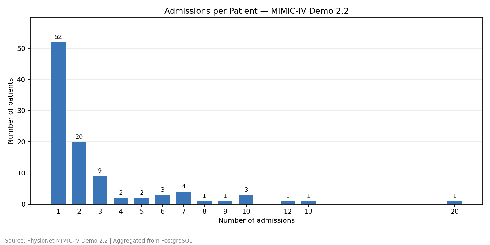
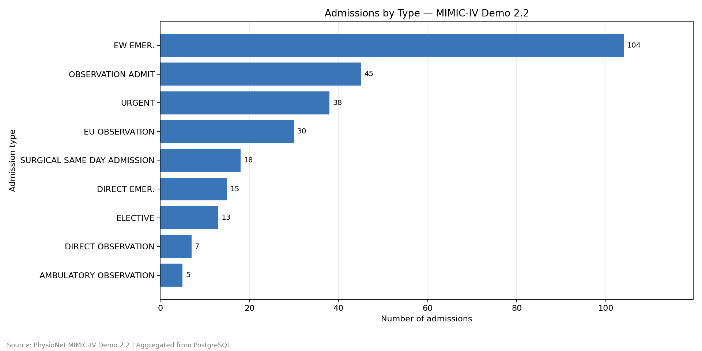

# MIMIC Data Pipeline

MIMIC-IV Demo 2.2 데이터를 수집하고 검증한 뒤,
MariaDB에 저장하고 PostgreSQL로 이관하는 Python 프로젝트입니다.

이관 전후의 데이터를 비교하고, 저장 중 오류가 발생했을 때
환자와 입원 데이터가 함께 롤백되는지 검증합니다.
이관한 데이터는 SQL로 분석하고 CSV와 그래프로 저장합니다.

## 프로젝트 목적

- CSV의 데이터 구조와 빈 값을 확인하고, 문자열을 정수나 날짜 등 필요한 자료형으로 변환합니다.
- 환자와 입원 테이블을 만들고 기본키, 외래키, CHECK 제약조건을 설정합니다.
- MariaDB 데이터를 PostgreSQL로 이관하고, 저장된 값이 같은지 비교합니다.
- 환자와 입원 데이터가 모두 저장되어야 커밋하고, 중간에 실패하면 함께 롤백하도록 구현합니다.
- SQL로 입원 데이터를 분석하고, 결과를 CSV와 그래프로 저장합니다.

## 데이터 범위

PhysioNet에서 제공하는 MIMIC-IV Demo 2.2의 두 테이블을 사용합니다.

| 데이터 | 한 행의 의미 | 행 수 |
|---|---|---:|
| patients | 환자 한 명 | 100 |
| admissions | 입원 한 건 | 275 |

한 환자에게 여러 입원 기록이 연결될 수 있으며,
두 테이블은 subject_id로 연결됩니다.

데이터 출처: https://physionet.org/content/mimic-iv-demo/2.2/

## 전체 처리 흐름

1. 원본 압축 파일 다운로드
2. 공식 SHA-256 값과 비교하여 다운로드한 파일이 원본과 같은지 확인
3. 압축 해제 및 CSV 읽기
4. ID 누락·중복과 각 입원 기록에 연결되는 환자가 있는지 확인
5. 문자열을 정수(int), 날짜(date), 날짜와 시각(datetime)으로 변환
6. MariaDB에 환자·입원 데이터 저장 및 값 비교
7. MariaDB에서 데이터를 읽어 PostgreSQL로 이관
8. MariaDB와 PostgreSQL에서 조회한 전체 데이터가 같은지 비교
9. PostgreSQL에서 입원 데이터 분석
10. 집계한 환자 수·입원 건수를 DB의 행 수와 비교하고 CSV·PNG 저장

## 사용 기술

| 기술 | 사용 목적 |
|---|---|
| Python 3.11 | 데이터 수집·변환·검증과 이관 실행 |
| MariaDB | CSV에서 변환한 데이터를 처음 저장하는 데이터베이스 |
| PostgreSQL | MariaDB 데이터를 이관받고 SQL 분석을 수행하는 데이터베이스 |
| Docker Compose | 두 데이터베이스의 실행 환경 구성 |
| PyMySQL | Python에서 MariaDB 연결 |
| Psycopg 3 | Python에서 PostgreSQL 연결 |
| python-dotenv | .env 파일의 접속 설정 읽기 |
| Matplotlib | 분석 결과를 막대그래프로 저장 |

## 파일별 역할

| 파일 | 역할 |
|---|---|
| main.py | 원본 다운로드, SHA-256 검증, CSV 읽기, 데이터 검증·변환, MariaDB 적재 |
| db.py | DB 연결, 데이터 저장·조회·비교, 트랜잭션 처리에 사용하는 공통 함수 |
| migrate.py | MariaDB 데이터를 읽어 PostgreSQL에 저장하고 이관 결과 검증 |
| test_transaction.py | 임시 테이블에서 저장 실패를 유도하고 두 테이블의 롤백 검증 |
| analysis.py | PostgreSQL 분석 쿼리 실행, 집계 결과 검증, CSV·그래프 저장 |
| sql/mariadb.sql | MariaDB의 환자·입원 테이블과 제약조건 정의 |
| sql/postgres.sql | PostgreSQL의 환자·입원 테이블, 제약조건과 인덱스 정의 |
| sql/analysis.sql | 환자별 입원 횟수를 계산하고 입원 횟수별 환자 수 집계 |
| sql/admission_type_distribution.sql | 입원 유형별 입원 건수 집계 |
| docker-compose.yaml | MariaDB·PostgreSQL 컨테이너, 포트, 볼륨, 상태 확인 설정 |
| requirements.txt | Python 패키지와 버전 명시 |
| .gitignore | 가상환경, 접속 설정, 원본 데이터 등 Git에서 제외할 경로 지정 |

### 데이터와 결과물 저장 위치

- `data/raw/`: 다운로드한 원본 압축 파일과 압축을 해제한 CSV
- `reports/`: 분석 결과 CSV와 그래프 PNG
- `.env`: 데이터베이스 접속에 사용하는 비밀번호 설정

원본 데이터와 `.env`는 Git에 포함하지 않습니다.
분석 결과 CSV와 PNG는 실행 결과를 확인할 수 있도록 저장소에 포함합니다.

### Python 실행 파일의 관계

- `main.py`는 원본 데이터를 준비하고 MariaDB에 저장합니다.
- `migrate.py`는 CSV를 다시 읽지 않고 MariaDB에 저장된 데이터를 읽어 이관합니다.
- `analysis.py`는 PostgreSQL에 저장된 데이터를 조회하여 분석합니다.
- 세 파일은 `db.py`의 공통 함수를 가져와 사용합니다.
- `db.py`를 직접 실행하면 두 데이터베이스의 접속 정보와 테이블 행 수를 확인합니다.

## 환경 설정 및 실행 방법

아래 명령은 macOS 터미널에서 프로젝트 최상위 폴더를 기준으로 실행합니다.

### 1. 실행 환경 준비

- Python 3.11
- Docker Desktop
- Git

Docker Desktop을 실행한 뒤 다음 명령으로 확인합니다.

```bash
docker version
docker compose version
```

### 2. Python 가상환경과 패키지 설치

가상환경이 없는 경우 생성합니다.

```bash
python3.11 -m venv .venv
```

가상환경을 활성화하고 패키지를 설치합니다.

```bash
source .venv/bin/activate
python -m pip install -r requirements.txt
```

PyCharm에서 이미 프로젝트 가상환경을 생성했다면 해당 환경을 사용합니다.

### 3. 데이터베이스 비밀번호 설정

프로젝트 최상위에 `.env` 파일을 만들고 아래 항목을 작성합니다.
각 값은 사용할 비밀번호로 변경합니다.

```dotenv
PIPELINE_MARIA_ROOT_PASSWORD=replace_with_root_password
PIPELINE_MARIA_PASSWORD=replace_with_mariadb_password
PIPELINE_PG_PASSWORD=replace_with_postgres_password
```

- `PIPELINE_MARIA_ROOT_PASSWORD`: MariaDB 관리자 비밀번호
- `PIPELINE_MARIA_PASSWORD`: Python에서 사용하는 MariaDB 계정 비밀번호
- `PIPELINE_PG_PASSWORD`: Python에서 사용하는 PostgreSQL 계정 비밀번호

`.env`는 Git에 포함하지 않습니다.

이 값은 데이터베이스 볼륨을 처음 초기화할 때 사용됩니다.
이미 초기화한 DB의 비밀번호는 `.env` 수정만으로 변경되지 않습니다.

### 4. 데이터베이스 실행

```bash
docker compose config --services
docker compose up -d --wait
docker compose ps
```

`mariadb`와 `postgres` 서비스가 모두 `healthy` 상태인지 확인합니다.

| 항목 | MariaDB | PostgreSQL |
|---|---|---|
| 호스트 | 127.0.0.1 | 127.0.0.1 |
| 호스트 포트 | 13306 | 15432 |
| 데이터베이스 | mimic_pipeline | mimic_pipeline |
| 사용자 | mimic | mimic |

같은 호스트 포트를 사용하는 다른 프로젝트의 컨테이너는 먼저 중지합니다.

DB 데이터는 Compose에 설정한 `maria_data`와 `pg_data` 볼륨에 저장됩니다.
컨테이너를 중지했다가 다시 실행해도 데이터가 유지됩니다.

### 5. 테이블 생성 — 최초 1회

현재 Compose 설정은 SQL 파일을 자동 실행하지 않으므로,
DB가 준비된 후 각 SQL 파일을 직접 실행합니다.

#### MariaDB

SQL 파일을 컨테이너에 복사합니다.

```bash
docker compose cp sql/mariadb.sql mariadb:/tmp/mariadb.sql
```

MariaDB에 접속하고 `PIPELINE_MARIA_PASSWORD`에 설정한 비밀번호를 입력합니다.

```bash
docker compose exec mariadb mariadb -h mariadb -u mimic -p mimic_pipeline
```

MariaDB 프롬프트에서 실행합니다.

```sql
SOURCE /tmp/mariadb.sql;
SHOW TABLES;
```

`patients`와 `admissions`가 생성된 것을 확인한 후 종료합니다.

```sql
exit;
```

#### PostgreSQL

SQL 파일을 컨테이너에 복사합니다.

```bash
docker compose cp sql/postgres.sql postgres:/tmp/postgres.sql
```

다음 명령을 실행하고 `PIPELINE_PG_PASSWORD`에 설정한 비밀번호를 입력합니다.

```bash
docker compose exec postgres psql -h postgres -U mimic -d mimic_pipeline -W -v ON_ERROR_STOP=1 -f /tmp/postgres.sql
```

SQL 파일은 `CREATE TABLE`을 사용하므로 이미 테이블이 존재하면 다시 실행하지 않습니다.

### 6. 데이터 수집·변환 및 MariaDB 적재

```bash
python main.py
```

원본 다운로드, SHA-256 검증, CSV 읽기, 데이터 검증·변환 후
MariaDB에 환자 100행과 입원 275행을 저장합니다.

### 7. PostgreSQL 이관

```bash
python migrate.py
```

MariaDB에 저장된 데이터를 읽어 PostgreSQL에 저장합니다.
두 테이블의 전체 조회 결과를 비교한 뒤 커밋합니다.

DB에 같은 데이터가 이미 있으면 다시 저장하지 않습니다.
입력 데이터와 다른 값이 저장되어 있으면 오류를 내고 작업을 중단합니다.
기존 데이터를 자동으로 수정하거나 덮어쓰지는 않습니다.

### 8. 저장 결과 확인

```bash
python db.py
```

두 데이터베이스에서 각각 다음 행 수가 조회되는지 확인합니다.

| 테이블 | MariaDB | PostgreSQL |
|---|---:|---:|
| patients | 100 | 100 |
| admissions | 275 | 275 |

행 수 확인과 별도로, 적재·이관 과정에서는 저장한 값도 비교합니다.

### 9. 롤백 테스트

두 데이터베이스의 적재·이관이 완료된 상태에서 실행합니다.

```bash
python test_transaction.py
```

각 데이터베이스의 임시 테이블에서 잘못된 사망 표시 값을 저장하여
입원 데이터 저장 실패 시 환자 데이터도 함께 롤백되는지 확인합니다.

### 10. 분석 결과 생성

```bash
python analysis.py
```

PostgreSQL에서 두 분석을 실행하고 합계를 검증한 뒤
`reports/` 폴더에 다음 파일을 생성합니다.

- `admission_count_distribution.csv`
- `admission_count_distribution.png`
- `admission_type_distribution.csv`
- `admission_type_distribution.png`

### 11. 작업 종료 및 재시작

데이터베이스 컨테이너를 중지합니다.

```bash
docker compose stop
```

다시 실행할 때는 다음 명령을 사용합니다.

```bash
docker compose up -d --wait
```

기존 볼륨이 유지되어 있으면 테이블 생성과 최초 적재를 반복할 필요가 없습니다.

## 트랜잭션 검증

MariaDB와 PostgreSQL에서 각각 임시 테이블을 만들어 테스트했습니다.

환자 데이터를 먼저 저장한 뒤, 입원 데이터의 `hospital_expire_flag`에
허용되지 않는 값인 `2`를 넣어 저장을 시도했습니다. 
(`CHECK (hospital_expire_flag IN (0, 1))` 제약조건으로 0과 1만 허용하기 때문입니다.)

입원 데이터 저장이 실패했을 때, 먼저 저장한 환자 데이터도 함께 롤백되는지 확인했습니다.
롤백 후 두 임시 테이블의 행 수는 모두 0이었습니다.

테스트가 끝난 뒤 실제 테이블의 행 수도 다시 확인했습니다.
두 DB 모두 환자 100행과 입원 275행이 유지되어 있었습니다.

## 분석 결과

분석은 PostgreSQL에 이관된 데이터를 기준으로 수행했습니다.
분석에서 계산한 환자 수와 입원 건수의 합계가 실제 테이블의 행 수와 같은지 확인했습니다.

### 1. 환자별 입원 횟수

환자별 입원 건수를 계산한 뒤, 같은 입원 횟수를 가진 환자 수를 집계했습니다.



- 전체 환자: 100명
- 전체 입원: 275건
- 입원 기록이 1건인 환자: 52명
- 입원 기록이 2건 이상인 환자: 48명
- 환자 한 명의 최대 입원 건수: 20건

환자 테이블을 기준으로 LEFT JOIN을 사용하여,
입원 기록이 없는 환자도 집계에 포함할 수 있도록 작성했습니다.
현재 데이터에는 입원 기록이 없는 환자가 없습니다.

이번 분석은 환자별 입원 기록의 개수만 집계했습니다.
퇴원 후 다시 입원하기까지 걸린 기간은 분석하지 않았습니다.

[입원 횟수별 분석 CSV](reports/admission_count_distribution.csv)

### 2. 입원 유형별 건수

입원 데이터를 admission_type으로 묶어 유형별 건수를 집계했습니다.



| 입원 유형 | 입원 건수 |
|---|---:|
| EW EMER. | 104 |
| OBSERVATION ADMIT | 45 |
| URGENT | 38 |
| EU OBSERVATION | 30 |
| SURGICAL SAME DAY ADMISSION | 18 |
| DIRECT EMER. | 15 |
| ELECTIVE | 13 |
| DIRECT OBSERVATION | 7 |
| AMBULATORY OBSERVATION | 5 |
| 합계 | 275 |

총 9개 유형 중 EW EMER.가 104건으로 가장 많았으며,
전체 입원 기록의 약 37.8%를 차지했습니다.

이번 분석은 입원 유형별로 입원 기록이 몇 건인지 집계했습니다.
같은 환자가 여러 번 입원했다면 각 입원 기록을 별도로 셉니다.

[입원 유형별 분석 CSV](reports/admission_type_distribution.csv)

## 프로젝트의 범위와 한계

- MIMIC-IV Demo 2.2의 환자 테이블(`patients`)과 입원 테이블(`admissions`)만 사용했습니다.
- 분석 결과는 이번에 사용한 데이터에 대한 결과이므로, 전체 환자의 특성을 나타내지는 않습니다.
- 데이터를 한 번에 메모리로 읽고 있어, 데이터가 많아지면 나누어 처리하는 방식이 필요합니다.
- 같은 데이터로 프로그램을 다시 실행해도 중복 저장되지 않습니다. 다만 기존 데이터가 달라졌을 때 자동으로 수정하는 기능은 구현하지 않았습니다.
- 환자와 입원 데이터는 각 DB에서 함께 저장하거나 롤백하도록 구현했습니다. 두 DB의 작업 전체를 한 번에 커밋하거나 롤백하는 방식은 아닙니다.
- 허용되지 않는 값을 넣어 저장이 실패했을 때 롤백되는지 확인했습니다. 네트워크 연결이 끊기거나 DB가 중단되는 상황까지 테스트하지는 않았습니다.
- 여러 프로그램이 동시에 데이터를 저장하거나 이관하는 상황은 아직 처리하지 않았습니다.